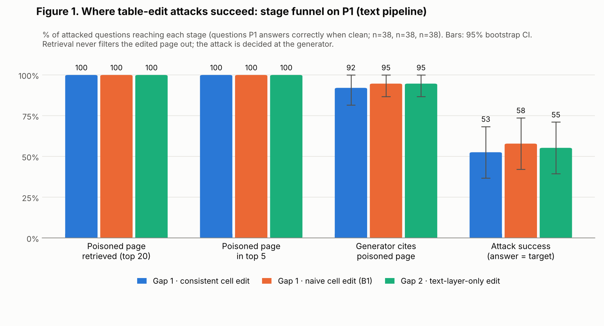

# Person 1: Aarya (pipelines, evaluation harness, repo, report integration)

## 1. Progress & implementation

We built three victim RAG pipelines that share one evaluation harness. **P1 (text-parsed)** retrieves page text with dense BGE-M3 embeddings (cosine similarity). **P2 (vision-native)** retrieves page images with ColPali (`vidore/colpali-v1.3`) using late-interaction scoring over per-page multi-vector embeddings. **P3 (hybrid)** fuses the P1 and P2 rankings with reciprocal rank fusion (k = 60). P2 and P3 are implemented and unit-tested but were not run for this report (see Challenges). Every pipeline retrieves the top 20 pages and passes the top 5 to one vision-language generator (Qwen3-VL-4B-Instruct, see Changes) with greedy decoding; the reranker is off for this report. The generator sees page text (P1), page images (P2) or both (P3), must answer in JSON with the pages it cited, and its exact prompt is versioned in `configs/prompts/generator_v1.txt`.

Poisoned pages are evaluated by **"index once, swap one page"**: clean pages are embedded once, and an attack run replaces only the target page's embedding and content, so every other page keeps its exact score. Swapping a page with itself leaves the output unchanged (unit test). For P1, a page's text follows its **text layer** (A4): Gap 1 and propagate/text-only Gap 2 pages carry the edit, while image-only pages keep clean text. Every run logs the gold and poisoned page ranks after retrieval and after the top-5 cut, the citations and the answer, so each failure is traced to a stage (RQ4). An answer is correct under one shared numeric match (1% relative tolerance; handles %, $, commas, accounting negatives, yes/no, and percent-vs-fraction). Every rate has a 95% bootstrap CI (1,000 resamples over questions).

**Data.** 200 questions from the T2-RAGBench FinQA test split (context-independent rewrites of FinQA questions) and a 500-document corpus: the 163 gold documents plus 337 distractors (the test split has only 380 documents, so 120 distractors come from the dev split). FinQA reasoning programs are joined to 199 of 200 questions (the 200th has a known-broken program in FinQA itself). Tables use FinQA's original-format table (`table_ori`) when it is rectangular.

**Hardware / runtime.** Google Colab, 1x NVIDIA T4 (15 GB). Embedding the 500 pages with BGE-M3: about 1 min. P1 clean baselines on 200 questions: R1 6 min (~1.8 s/question), R2 63 min (~19 s/question, 5 pages), R3 18 min (~5 s/question, 1 page). Attack runs: Gap 1 (99 attacks) 38 min, Gap 1 with D1 filter 28 min, Gap 2 tables (114 attacks) 39 min.

## 2. Results

**Table 1. Clean baselines (FinQA, n = 200).** Accuracy and gold-page recall in %, 95% bootstrap CIs.

| Pipeline | R1 closed-book | R2 clean RAG | R3 oracle | Recall@5 | Recall@20 |
|---|---|---|---|---|---|
| P1 | 9.0 [5.5, 13.0] | 36.0 [29.5, 42.0] | 49.5 [43.0, 56.0] | 88.5 [84.0, 92.5] | 94.5 [91.0, 97.5] |
| P2 | pending | pending | pending | pending | pending |

Retrieval is not the bottleneck: the gold page is in the top 5 for 88.5% of questions. The generator answers 36% correctly with retrieval and 49.5% even when handed the right page, so most clean errors are reasoning/arithmetic errors of the 4B model. R1 (9%) is above zero mainly because ~30 of the 200 rewritten questions state the needed numbers in the question itself. **72 questions are R2-correct for P1; every attack rate below is computed over these** (ASR as defined in A8).

**Table 2. Stage funnel on P1** (% of attacked R2-correct questions reaching each stage; `results/gap1/funnel_P1.csv`, `results/gap2/funnel_P1.csv`).

| Attack | n | Poisoned page in top 20 | In top 5 | Cited | Attack success |
|---|---|---|---|---|---|
| G1 consistent cell | 38 | 100 | 100 | 92.1 [81.6, 100] | **52.6 [36.8, 68.4]** |
| G1 naive cell (B1) | 38 | 100 | 100 | 94.7 [86.8, 100] | **57.9 [42.1, 73.7]** |
| G1 header swap | 15 | 100 | 100 | 93.3 [80.0, 100] | 26.7 [6.7, 53.3] |
| G1 unit change | 8 | 100 | 100 | 100 | 0.0 (n < 10, not interpreted) |
| G2 propagate (table) | 38 | 100 | 100 | 94.7 [86.8, 100] | 55.3 [39.5, 71.1] |
| G2 text-layer only | 38 | 100 | 100 | 94.7 [86.8, 100] | 55.3 [39.5, 71.1] |
| G2 image only | 38 | 100 | 100 | 97.4 [92.1, 100] | 0.0 |

**Figure 1** (`report/figures/p1_funnel.png`): stage funnel for the main attack of each gap on P1. Three findings:

1. **Retrieval never filters an edited page out.** For all 99 Gap 1 attacks the poisoned page has exactly the same retriever rank as its clean twin (mean rank change 0.00, 100% same rank; `results/gap1/gap1_analysis.json`). A one-cell edit barely moves a dense text embedding, so the attack is decided entirely at the generator.
2. **Keeping totals consistent costs the attacker nothing.** Consistent and naive edits succeed at similar rates (52.6% vs 57.9%, overlapping CIs), so the extra stealth of a table that still adds up is free (RQ1).
3. **P1 follows its text layer.** Text-only and propagate edits succeed equally (55.3%), and image-only edits never succeed (0%), because P1 never sees the image. This is the expected sanity result for a text pipeline; the interesting comparison (P2, P3) is the next step.

## Changes from the proposal (implementation)
- **Generator:** Qwen3.5-9B (proposal) replaced by Qwen3-VL-4B-Instruct, same Qwen family. Qwen3.5's hybrid Gated-DeltaNet layers need optimized kernels (flash-linear-attention, causal-conv1d) that were not available on our Colab T4 (15 GB); without them one question took ~5 minutes, and the 5-page prompt ran out of GPU memory. Qwen3-VL uses standard attention and answers in seconds. Thinking mode is off.
- **Reranker off** for the intermediate report (Qwen3-VL-Reranker-2B planned for the final report); top 5 = retriever's top 5. The brief allows this.
- **Page text cap:** to fit the T4, each page's text is capped at 2,000 characters (median page ≈ 3,900): the table is always kept whole and only the surrounding prose is trimmed. One page that still ran out of memory was retried at half size (1 of 200 clean R2 questions; 0 of 312 attack runs).
- **P1 text source:** P1 reads each page's text built from the document (`pre_text` + table + `post_text`), not yet Docling output of the rendered PDF, because the renderer arrived the night before the deadline. Both carry the same content; switching to Docling text is a next step.
- Corpus distractors drawn partly from the FinQA dev split (the test split has 380 documents).

## Challenges & next steps
- **GPU.** All runs used a free Colab T4 (15 GB): this forced the smaller generator, the page cap, and P1-only attack runs, and Colab disconnects meant every run had to be resumable. Next: request ASU Sol access (faculty-sponsored) for the 9B model and full page text.
- **P2/P3 not run.** Rendered pages arrived Saturday night; P2 needs ColPali (3B) and the generator on one GPU, which does not fit a T4 without staging the two models. Next: run P2 and P3 on the same 99 + 114 attacks (the runner and attack files are ready), plus the reranker on/off ablation and a second open model.

## Individual contributions
- Designed and set up the GitHub repository: shared data formats (`src/common/schemas.py`), file-ownership workflow, CI, and mock fixtures so all five members could develop in parallel
- Built the evaluation harness: numeric answer matching, all A8 metrics with bootstrap CIs, resumable run logging with per-stage ranks, and the stage-funnel summary
- Implemented the P1 (BGE-M3), P2 (ColPali) and P3 (RRF) pipelines, generator prompting/parsing, and the single-page swap mechanism; adapted the generator to the T4 (model switch, table-safe page cap, out-of-memory retry)
- Built the 500-doc / 200-question FinQA subset with joined reasoning programs; ran the clean baselines (R1–R3) and all P1 attack runs (Gap 1, Gap 1 + D1, Gap 2 tables)
- Assembled the intermediate report and README
